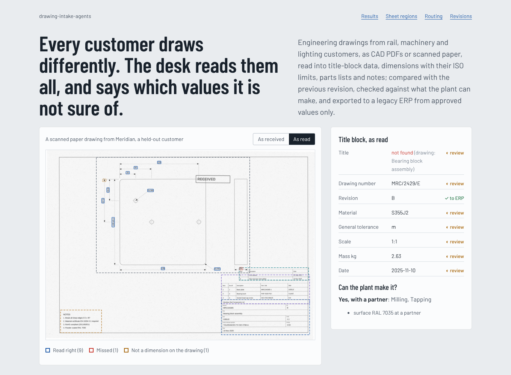
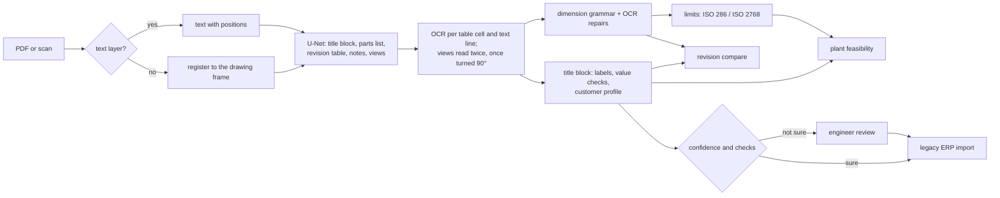

# drawing-intake-agents

[](https://github.com/manojrevenkar12-web/drawing-intake-agents/actions/workflows/ci.yml)

A supplier to rail, machinery and lighting companies gets engineering drawings from every customer in that
customer's own template: CAD PDFs from some, scanned paper from others, German from one, English abbreviations from
the next. Before anyone can quote or plan, an engineer reads each drawing, types the title block into the ERP, works
out the real limits of every toleranced dimension, checks whether the plant can hold them, and compares the drawing
with the revision before it.

This repository does that reading. It finds the parts of the sheet with a small segmentation network, reads text
from the PDF's text layer or with OCR after registering the scan to its frame, parses dimensions and resolves their
limits from ISO 286-1 and ISO 2768-1, compares revisions, decides make in house / with a partner / decline against the
plant's settings, and sends to a legacy ERP only the values it is sure of or an engineer has approved. A new
customer's template is learnt from one or two of their drawings.



## Dashboard

Held-out customers: three customer layouts (other labels, abbreviations, a parts list above the title block, an A4
sheet) that were never used to build, train or tune anything, pinned in `config/heldout.lock` and run once. Full
tables, with the development numbers next to them, are in [RESULTS.md](RESULTS.md).

| Held-out customers, 89 drawings (51 CAD PDFs, 38 scans) | Result |
|---|---|
| Title-block fields read right | **92.1%** (CAD PDFs 95.8%, scans 87.2%) |
| ... after learning the customer from one of their drawings | **92.2% → 99.1%** (99.1% with three) |
| Dimensions read exactly: value, tolerance and count | **91.4%** (CAD PDFs 98.7%, scans 81.9%); precision 91.0% |
| Limits of size right (ISO 286 fits, explicit, ISO 2768 general) | **96.3%** |
| Parts-list cells right | 78.3% of 92 |
| Note requirements found (surface, heat treatment, certificates, ...) | 91.5% recall, 100% precision |
| Revision changes reported as certain | 81.4% precision, 70.0% recall; 80.0% found or flagged for a look |
| Make / partner / decline decision the same as from the drawing itself | **96.6%** |
| Fields sent straight to the ERP / wrong among them | 47.6% / **1 of 339** |
| Region finding, U-Net vs one average template (mean IoU) | revision table 73% vs 36%, views 75% vs 53%, title block 88% vs 82% |
| Tests | 49 Python, 5 web |

The held-out run is weaker than development where it should be: with no example drawings, the part title is read
right only 45% of the time on the new layouts, and more values are found by their shape rather than their label,
so fewer fields go straight to the ERP (47.6% against 73.7% on development). One example drawing of the customer
brings the title block to 99.1%.

## How it works



- **Pages.** A CAD PDF's text layer is read with positions and writing direction. A scan is registered to its ISO
  5457 drawing frame (the largest rectangle on the page), which removes skew and shift in one affine step.
- **Regions** (`perceive/regions.py`). A U-Net (four levels, 256 px wide input) trained on the development layouts
  segments the sheet; components become boxes. Leaving one development layout out shows where it fails: a revision
  table in a position never seen in training (1% IoU when `sitec` is left out), which is why all five arrangements
  are in the final training set.
- **OCR** (`perceive/ocr.py`). Tables are split into cells by their ruling lines and cells into text lines; each line
  is enlarged to the height Tesseract reads best, which is what makes 5 pt labels legible at all. Views are read
  sparsely as is and turned 90° for vertical dimensions, then every text block the sparse pass missed is read alone.
- **Title block** (`perceive/fields.py`). Labels are matched loosely against ISO 7200 terms and the development
  customers' labels; values are checked (date formats, scale, ISO 2768 class, the material master); missing fields
  are looked for by the shape of their value and cross-checked with the revision table. A **customer profile** learns,
  from a few drawings with known values, the customer's own labels and where each value sits relative to the general
  tolerance, which keeps working where the label itself is too small to read.
- **Dimensions** (`perceive/dimensions.py`). A small grammar (`[n x] [Ø|R|M] value [x45°] [±t | +a/-b | fit]`) with
  repairs for what OCR does to drawings: Ø read as @, 0 or 8; ± read as #, + or a sideways I+; decimal commas. A
  repaired text is marked and goes to review.
- **Engineering.** Limits from the ISO tables (`standards/`); revision compare aligns the two sheets on dimensions
  that read identically, pairs the rest with an optimal assignment, and marks a change as uncertain if it could be a
  reading error; feasibility maps each tolerance to the ISO grade a process must hold, against `config/plant.yaml`.
- **Notes.** Rules in English and German; an LLM reader (Anthropic Messages API) can add requirements, but only
  through a validator that rejects anything whose quoted text is not in the notes or whose standard is unknown.
- **Delivery.** Routing by confidence (threshold chosen on development drawings), fixed-width ERP import records with
  an idempotency key, a stand-in for the ERP's import job, and a FastAPI service with an onboarding endpoint for a
  new customer.

## The simulated customers

There are no real customer drawings here, so `dia.world` makes them: plates, shafts, flanges, brackets and small
assemblies with real tolerancing (ISO 286 fits on bores and seats, explicit and general tolerances), notes from a
set of real requirement types, parts lists and revision histories, drawn in eight customer layouts with different
fonts, languages, label wording, cell arrangements, date formats and decimal separators, on A3 or A4. Half arrive as
scans: rasterised at 200 dpi, skewed, shifted, blurred, noisy, stamped and JPEG-compressed. Half come with their
previous revision and one to three known changes. The truth stays in `data/truth/`, which nothing that serves reads.

## Run it

```bash
sudo apt-get install tesseract-ocr tesseract-ocr-deu
pip install --extra-index-url https://download.pytorch.org/whl/cpu -e ".[dev]"
make test                 # 49 tests, about 15 seconds
make data dev report      # generate the drawings, read and score the development set (about 20 minutes)
make api                  # POST /api/drawings with a PDF or image
cd web && npm ci && npm run dev
```

```bash
curl -F file=@drawing.pdf -F customer=acme localhost:8000/api/drawings
curl -X POST localhost:8000/api/drawings/<id>/approve -H 'content-type: application/json' -d '{"title": "Base plate"}'
curl -X POST localhost:8000/api/drawings/<id>/export
```

## Limits

- The drawings are generated. Real drawings have sections, details, GD&T frames, surface symbols, hand-written
  redlines and far more views; none of that is read here, and the numbers above say nothing about it.
- Scans are simulated at 200 dpi with one kind of degradation. Fax-quality scans or photos of drawings will do worse.
- ISO 286 classes outside H, f, g, h and js, and sizes above 500 mm, are reported as not resolvable.
- The LLM note reader is tested with recorded answers, not benchmarked; the numbers come from the rule reader.
- The time estimate (20 minutes per drawing by hand, half a minute per reviewed field) is an assumption in
  `config/dia.toml`, not a measurement.
- The held-out set is spent. Changing the reader needs new, unseen layouts.
